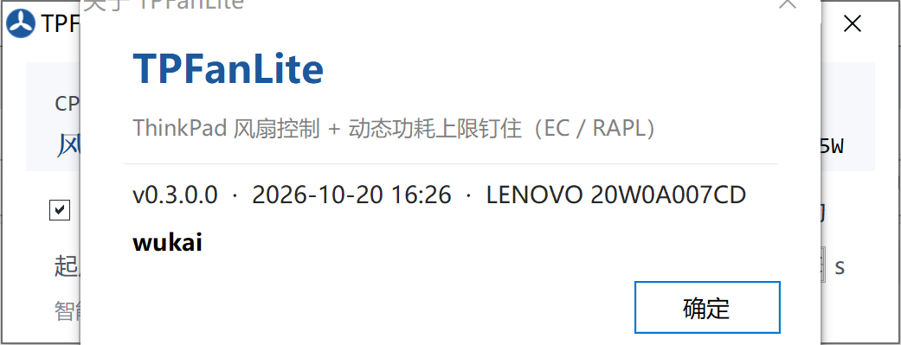

# TPFanLite

> ThinkPad 风扇控制 + 动态功耗上限（PL1）钉住 —— 解决 **ThinkPad T14 Gen 2i 满载掉频到 0.4/0.8GHz** 的问题。



[](LICENSE)


- **轻量**：单 exe（约 150 KB），无安装器、无服务、无后台驻留；关掉即退出
- **风扇**：EC 自动 / MAX 全速两级；智能控制纯温度驱动（起点全速、起点−回差回自动）
- **功率**：把被 EC 固件压到 8–12W 的动态 PL1 钉回 35W（MCHBAR `0xFEDC0000+0x59A0`，100ms 重写），8 线程满载实测约 **1.73×** 性能
- **适用**：ThinkPad T14 Gen 2i（20W0A007CD）实测可用；同代 TGL-U + Lenovo EC 机型风扇功能可用，PL1 钉住会因寄存器自检失败自动禁用（不会盲写）

> 适用机器详细背景：LENOVO 20W0A007CD = ThinkPad T14 Gen 2i（i7-1165G7，Win10 IoT LTSC 19044，BIOS 1.71）
> 设计与调查依据：[设计日志.md](设计日志.md)、[docs/掉频根因与PL1钉住方案.md](docs/掉频根因与PL1钉住方案.md)

---

## 1. 这个程序做什么

| 分类 | 功能 | 说明 |
|---|---|---|
| **功率** | **PL1 钉住**（核心） | EC 固件会把动态 PL1 从 35W 磨到 8W 导致 CPU 卡 0.4–0.8GHz；程序每 100ms 重写 `MCHBAR+0x59A0` 把 PL1 钉在目标值 |
| 风扇 | EC 自动 / MAX 全速 | 两档；写 EC `0x2F`（`0x80`/`0x40`） |
| 调度 | **智能控制** | 风扇纯温度驱动（≥起点全速，≤起点−回差回自动）；功率按 N 级阶梯随温度下压（起点→高点分 N 档，35→20W）；温度只看五项：起点/高点/档位/回差/稳定 |
| 保护 | 高温释放 / 兜底自救 | ≥高点持续「稳定」暂停钉住，≤高点−回差持续「稳定」重新接管；钉住失效时全速风扇救急 |
| 其它 | 开机启动 / 托盘 / 睡眠模式 | 睡眠模式 = BIOS `SleepState`（Linux=S3 / Windows 10=现代待机），改完需重启 |

**不依赖**：PawnIO、HWiNFO、任何新软件。只用本机已有的 **TVicPort 驱动**（EC 访问本来就依赖它）。

---

## 2. 安装（新用户）

### 2.1 前置条件

| 项 | 要求 |
|---|---|
| 机器 | **同型号**：ThinkPad T14 Gen 2i（20W0A007CD）/ 同代 TGL-U + Lenovo EC。其他机型风扇功能可用，但 PL1 钉住会因寄存器自检失败而自动禁用 |
| BIOS | 1.71（N34ET71W）实测有效；其他版本可能偏移不同，程序会自检拒绝而不盲写 |
| 系统 | Windows 10 / 11 x64（.NET Framework 4.x 系统自带） |
| 驱动 | **TVicPort**（x86 用户态 DLL + 64 位内核驱动），程序唯一依赖 |
| 权限 | 平时**不需要**管理员；只有两个操作要提权：安装 TVicPort 驱动、改 BIOS 睡眠模式 |

### 2.2 需要准备的文件

| 文件 | 来源 | 说明 |
|---|---|---|
| `TPFanLite.exe` | 本仓库 Releases | 主程序（x86，.NET Framework 4.x 系统自带） |
| `TVicPort.dll` | EnTech Taiwan（免费） | 32 位用户态库，放在程序目录 |
| `TVicPort64.sys` | EnTech Taiwan（免费） | 64 位内核驱动，放在程序目录（驱动自安装会读取） |

TVicPort 下载：<http://www.entechtaiwan.com/files/tvicport.zip>（产品页 <https://www.entechtaiwan.com/dev/port/index.shtm>）。

> 本仓库**不分发** TVicPort 的二进制（详情见 [assets/README.md](assets/README.md)）。EnTech 允许随软件免费再分发，但由使用者自行获取可避免版本与授权歧义。
>
> 自己构建时：把 `TVicPort64.sys` 放到 `assets\` 再运行 `build.ps1`，驱动会内嵌进 exe（开箱自装）；或直接 `build.ps1 -NoDriver`，运行时从程序目录读取。

### 2.3 安装步骤

**① 安装 TVicPort 驱动**（只需要一次，程序会自己装）

驱动 `TVicPort64.sys` 若已内嵌（完整版构建）或放在程序目录，首次启动检测不到驱动时会弹窗询问，点"是"即自动安装（弹一次 UAC）：

```
未检测到 TVicPort 驱动（风扇、温度、PL1 钉住都依赖它）。
是否现在安装？需要管理员权限，会弹一次 UAC。
```

也可以手动触发（管理员）：

```powershell
TPFanLite.exe --install-driver        # 幂等：已安装会直接跳过
```

装完自动验证：日志在 `%LOCALAPPDATA%\TPFanLite\driver-install.log`，成功时最后一行是 `OK 驱动安装完成` 且 `OpenTVicPort => True`。

> 卸载驱动同样可程序内完成：托盘 → `TVicPort 驱动` → `卸载`（会先确认，成功后程序自动退出）；命令行对应 `TPFanLite.exe --uninstall-driver`。

**② 复制程序文件**

```powershell
$dst = Join-Path $env:LOCALAPPDATA 'TPFanLite'
New-Item -ItemType Directory -Force $dst | Out-Null
Copy-Item TPFanLite.exe, TVicPort.dll, TPFanLite.ico $dst
```

（`TPFanLite.ini` 首次运行自动生成；只有在升级时才需要保留旧 ini。）

**③ 启动**

双击 `%LOCALAPPDATA%\TPFanLite\TPFanLite.exe`。首次启动会创建 `TPFanLite.ini` 与日志。程序不驻留服务，关掉即退出。

**④ 验证安装成功**

| 检查 | 期望 |
|---|---|
| 界面 | 显示 CPU/APS/CRD/BAT 温度、风扇 rpm |
| 电源行 | `PL1 xx.xW PINxxW`（`PIN` = 钉住目标；若是 `N/A` 说明钉住不可用） |
| `%LOCALAPPDATA%\TPFanLite\pl1pin.log` | 出现 `在线 MCHBAR=0xFEDC0000 PL1=… PL2=…` |
| 8 线程负载 1 分钟 | PL1 不再滑落到 8W，CPU 保持 2.5–3.5GHz |

**⑤ 可选：开机启动**

界面勾选"开机启动"（写 `HKCU\...\Run`，`--tray` 静默启动）。若被安全软件拦，程序会提示改用 `reg.exe` 回退。

### 2.4 从源码构建（开发者）

```powershell
powershell -NoProfile -ExecutionPolicy Bypass -File .\build.ps1   # → TPFanLite.exe
powershell -NoProfile -ExecutionPolicy Bypass -File .\deploy.ps1  # 停旧实例→复制到 %LOCALAPPDATA%\TPFanLite→启动
```

`build.ps1` 用系统自带 `C:\Windows\Microsoft.NET\Framework\v4.0.30319\csc.exe` 编译（`/platform:x86`），无需 VS。
-NoDriver 构建不含内嵌驱动（CI 与不分发二进制的场景用），运行时从程序目录读取 TVicPort64.sys。

### 2.5 卸载

```powershell
# 1) 界面取消"开机启动"，退出程序（退出即停止 PL1 重写，固件 <200ms 接管）
# 2) 删除程序目录
Remove-Item (Join-Path $env:LOCALAPPDATA 'TPFanLite') -Recurse -Force
# 3) 卸载 TVicPort 驱动（程序托盘「TVicPort 驱动 → 卸载」，或管理员运行 tools\uninstall-tvicport.cmd）
tools\uninstall-tvicport.cmd
```

### 2.6 安装常见问题

| 现象 | 处理 |
|---|---|
| 双击无窗口/进程即退 | 单实例已存在（托盘图标）；或看 `%LOCALAPPDATA%\TPFanLite\tpfanlite-startup.log` |
| 电源行 `PL1 … N/A` | 驱动未运行或自检失败：先看 `pl1pin.log` 的 `FAIL`，再跑 `TPFanLite.exe --install-driver`（或托盘「安装/修复 TVicPort 驱动」） |
| 开机启动勾选失败 | 火绒 HIPS 拦截写注册表；按弹窗提示加白或换安装目录 |
| 首次运行火绒报驱动 | TVicPort64 是 2006 年老驱动（仅有端口/内存映射 IOCTL），需在火绒放行 |

---

## 3. 界面

```
CPU 72C  APS 55C  CRD 33C  BAT 40C
风扇  4054 rpm            PL1 30.0W PIN30W
☑ EC 自动   ☐ MAX 全速   ☑ 智能控制   ☑ 开机启动
起点 [75]°  高点 [98]°  档位 [3]  回差 [5]°  稳定 [5]s
状态行
```

- **勾选行**：EC 自动 / MAX 全速 二选一；智能控制与开机启动独立勾选
- **电池模式**：智能控制默认整体暂停（风扇回基底档位、功率不钉，状态栏显示"电池模式·智能控制暂停"）；勾选托盘「性能优先」后电池下与 AC 一样完整调度（风扇 + 功率）
- **参数行**：可直接改，改完即时生效并写 ini；上限 35W / 下限 20W 只在 ini
- **状态码**：`0` 正常、`1` MAX 全速、`2` 智能全速、`3` 高温释放、`4` 兜底自救

托盘菜单：`显示主窗口 / EC 自动 / MAX 全速 / 性能优先 / 睡眠模式（Linux S3、Windows 10）/ TVicPort 驱动（安装·修复 / 卸载）/ 关于 / 退出`
（钉住常开；**急停 = 退出程序**，退出后固件 <200ms 自行接管）

「关于」窗口显示：版本、构建日期、本机型号、作者（wukai）。

---

## 4. 配置项（`TPFanLite.ini`）

GUI 第 2 行可改五项：`起点 / 高点 / 档位 / 回差 / 稳定`（对应 ini `TempStart / TempPowerHigh / PowerSteps / TempHyst / HoldMs`）。其余只在 ini：

```ini
; ---- 模式 ----
Mode=auto                 ; auto（智能控制）| full（MAX 全速）

; ---- 智能控制：风扇 / 功率 ----
SmartEnabled=True
TempStart=75              ; 起点：风扇全速 + 功率阶梯起点
TempHyst=5                ; 回差：风扇释放 = 起点−回差(70)；重新接管 = 高点−回差(93)
HoldMs=5000               ; 稳定：所有温控确认时长（风扇升降 / 档位切换 / 释放 / 接管）
PinPl1=True               ; 功率钉住总开关（默认仅 AC 生效）
PerfFirst=False           ; 性能优先：电池供电时也启用智能控制（风扇 + 功率，托盘可切换）
PinPl1MaxW=35.0           ; 额定上限（GUI 不提供修改）
PinPl1MinW=20.0           ; 高温下限（GUI 不提供修改）
TempPowerHigh=98          ; 高点：阶梯末级(20W) + 暂停钉住点
PowerSteps=3              ; 阶梯档位数（1..8）；阶梯内部回差固定 0.5/1.5

; ---- 兜底自救（钉住失效时）----
RescueEnabled=True
RescuePl1W=18.0
RescuePl1DwellMs=5000
RescueBusyMinPct=25
RescueExitPl1W=28.0
RescueExitDwellMs=12000
RescueExitBusyPct=20

; ---- 其它 ----
DiagLog=True              ; 1Hz 诊断 CSV
CloseToTray=True
MinimizeToTray=True
AlwaysOnTop=True
```

---

## 5. 日志与复盘

| 文件（`%LOCALAPPDATA%\TPFanLite\`） | 内容 |
|---|---|
| `diag-v4-YYYYMMDD.csv` | 1Hz 现场：温度/转速/PL1/目标/钉住状态/阶梯级/平滑温度/busy/风扇/状态码/供电 |
| `smart.log` | 配置快照（启动与改参数时）+ 风扇 ON/OFF、阶梯切换、释放/接管、自救迁移 |
| `pl1pin.log` | MCHBAR 映射结果、自检、异常 |
| `bios-op.log` | 睡眠模式写入结果（SET/SAVE/READBACK） |
| `tpfanlite-startup.log` | 开机启动注册结果 |

跑一段时间后体检：

```powershell
pwsh -File tools\log-check.ps1            # 自动找最新 diag-v4
pwsh -File tools\log-check.ps1 -Top 20    # 最长 20 段全速事件
```

---

## 6. 排障

| 现象 | 处理 |
|---|---|
| 卡顿但 `PINxxW` 正常 | 看 diag `pl1_w` 是否≈`pin_w`；若 `pin_state=2` 是高温释放，先降温 |
| `PL1 xx.xW N/A` | MCHBAR 映射/自检失败 → 看 `pl1pin.log` 的 FAIL 行；驱动问题跑 `--install-driver` 重装 |
| `PIN OFF` | ini `PinPl1=False` |
| 风扇常全速 | 温度 ≥起点就会全速，且要降到 ≤起点−回差 持续「稳定」才退；房间热/积灰时正常。嫌吵可把 GUI「起点」调高或「回差」调大 |
| 高温释放频繁（≥高点 98°C） | 散热异常或 `PinPl1MaxW` 偏高；检查风扇/进风口/硅脂 |

---

## 7. 换机 / 重装系统 / BIOS 升级

- **重装系统 / 新用户**：按 §2.3 的 ①→⑤ 走一遍（装 TVicPort → 拷文件 → 启动 → 验证 → 开机启动）。
- **开启"开机启动"**：写 `HKCU\Software\Microsoft\Windows\CurrentVersion\Run`，值为 `"<exe>" --tray`（无需管理员）。
- **换机 / 刷了别的 BIOS 版本**：`0x59A0` 偏移可能不同。程序启动自检会校验 PL1/PL2 原始值范围，不符时禁用钉住并写 `pl1pin.log` 的 `FAIL …`（**不会盲写**）。此时按 `docs/掉频根因与PL1钉住方案.md` §3.2 从该机 BIOS/ACPI 表重新确认偏移，再用 §3.6 的脚本验证读/写。
- **换机后风扇/EC 功能**：只依赖 TVicPort 端口，同系列 ThinkPad 一般可直接用；异型机需重核 EC 端口与寄存器。

---

## 8. 目录说明

```
src/              源码（AssemblyInfo/Bios/Cfg/CpuBusy/Ec/MainForm/Pl1Pin/Program/SmartCtrl）+ 图标
docs/             调查报告与界面截图
assets/           TVicPort 二进制存放处（内容不入库，见 assets/README.md）
tools/            log-check.ps1（日志体检）、uninstall-tvicport.cmd（卸载驱动）
.github/workflows build.yml（push/PR 编译）、release.yml（打 tag 出包，不含驱动）
build.ps1         编译（csc，x86）；-NoDriver 不内嵌驱动
deploy.ps1        部署到 %LOCALAPPDATA%\TPFanLite 并启动
设计日志.md        逐节开发/实验记录（含全部侦察过程与实测数据）
CHANGELOG.md      版本变更
```

---

## 9. 免责声明

本项目通过驱动直接读写 **EC（嵌入式控制器）** 与 **MCHBAR（功耗管理寄存器）**，属于未公开的硬件接口：

- 仅在同型号机器上做过完整实测，其他机型可能读数/写入无效，极端情况下可能导致蓝屏或散热异常
- 开机自检会校验 PL1/PL2 原始值，不符时自动禁用钉住（不会盲写）；但**使用风险仍由使用者自行承担**
- 修改风扇转速与功耗上限可能影响整机保修，且高温下长时间满速运行会加速风扇磨损
- 本项目与 Lenovo / EnTech Taiwan 无关

## 10. 许可证

[MIT](LICENSE) © 2026 wukai

TVicPort 驱动与 DLL 的版权归 EnTech Taiwan 所有（<https://www.entechtaiwan.com/dev/index.shtm>），不在本许可证范围内，也不随本仓库分发。